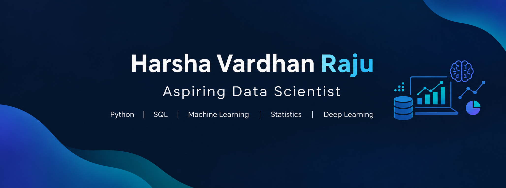

  

## 👨‍💻 About Me

👋 Hi, I'm Harsha Vardhan Raju, passionate about Data Science, Machine Learning, and uncovering insights hidden within data.

📊 Skilled in Python, SQL, Statistics, and Exploratory Data Analysis, with a focus on solving real-world problems through data-driven approaches.

🤖 Built projects in Natural Language Processing (NLP), Neural Networks, Time Series Forecasting, and Machine Learning.

🚀 Constantly exploring new techniques, experimenting with data, and building intelligent solutions that turn complex problems into meaningful results.

and... "A LIFE LONG LEARNER"

### 🎯 Current Focus
- Building end-to-end Data Science projects
- Developing predictive machine learning models
- Applying statistical methods to real-world datasets
- Exploring practical applications of AI and Machine Learning
## 🧰 Tech stack

  

  
  
  
  
  
  
  
  
  
  
  
  

### 🤝 Let's Connect
Open to opportunities in Data Science, Machine Learning, and Data Analytics.
